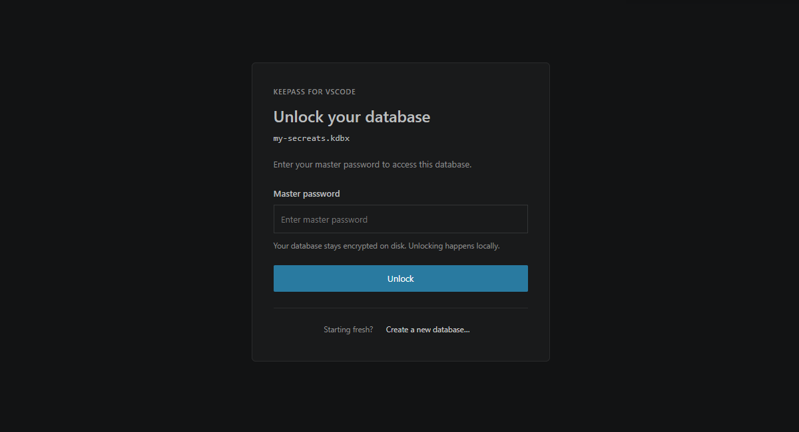
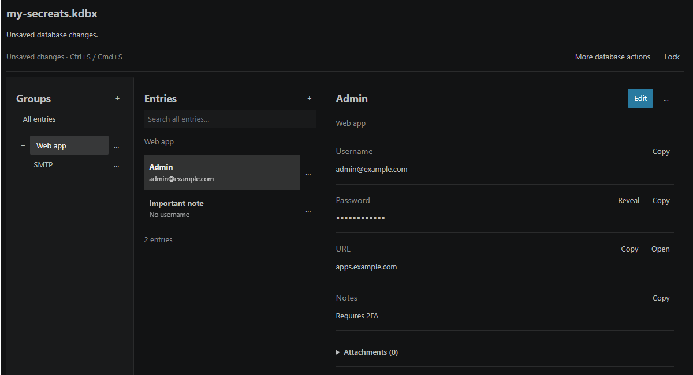
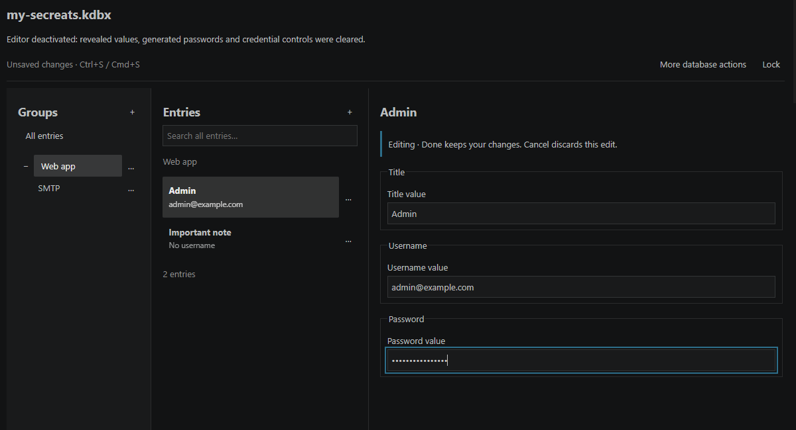

# KDBX for VS Code

Open and manage KeePass-compatible password databases directly in Visual Studio Code.

- KeePass / KeePassXC compatible
- KDBX 4.0 and 4.1
- Passwords, custom fields, notes and attachments
- Local only - no cloud service or account
- Encrypted recovery
- Automatic locking and clipboard clearing
- Open source





## Features

- Create databases, organize groups and entries, and search titles, usernames,
  URLs, tags and group paths.
- Manage protected custom fields, multiline notes, entry history and recycle-bin items.
- Generate passwords, explicitly reveal or copy credentials, and change the master password.
- Import and export attachments using native file pickers.
- Use VS Code Save, Save As, undo/redo, split editors and encrypted recovery.

This is an independent project, not an official KeePass or KeePassXC product.

## Security model

Databases are encrypted on disk. Unlocked database models and key material are
held in local workers; the editor receives browsing data and explicitly requested
secrets. Workers are not a security sandbox: plaintext also exists in the
extension host and webview during input, editing, reveal and copy operations.

Manual locking is always available. Automatic locking defaults to **5 minutes**
without database interaction; `kdbx.idleLockMinutes` accepts 0-120, and **0 disables
automatic locking**. Hiding the editor or losing window focus conceals visible secrets.
Copied credentials are cleared after **30 seconds**, only if the clipboard still
contains the extension's copy. Clipboard history is outside its control.

Keep separate backups. Read [SECURITY.md](SECURITY.md) for the trust boundaries,
recovery behavior and threat model.

## Supported databases

- Open and edit **KDBX 4.0 and 4.1**; create new **KDBX 4.1** databases.
- Ciphers: **AES-256** and **ChaCha20**.
- Key derivation: **Argon2id**, **Argon2d** and **AES-KDF**, within resource limits.
- Authentication: **master password only**; key files and hardware tokens are not supported.

Ordinary saves preserve the format, cipher and KDF. Edits requiring newer metadata,
such as moves, upgrade KDBX 4.0 to 4.1. Databases containing data the editor cannot
preserve open read-only rather than risking a lossy save. KeePass 1.x `.kdb` and
KDBX 3.x are not supported.

## Installation

Requires **VS Code 1.101.0 or newer** on Windows, macOS or Linux, in a trusted
local desktop window.

Install **KDBX for VS Code** (`erlihs.vscode-kdbx`) from the Extensions view when
available. For a locally built VSIX, run **Extensions: Install from VSIX** and
select the package. See [development instructions](https://github.com/erlihs/vscode-kdbx/blob/HEAD/docs/technical.md#development-and-validation)
to build it.

## Usage

1. Open a `.kdbx` file, or run **KDBX: Create Database** from the Command Palette.
2. Unlock with its master password.
3. Select a group and entry. Use **+** to create items, **Edit** to change an
   entry, and **Done** to finish the edit.
4. Save with Ctrl+S (Cmd+S on macOS). Inside the editor this finishes the active
   edit and saves the encrypted database; normal VS Code Save persists finished changes.
5. Run **KDBX: Lock Database** or **KDBX: Lock All Databases** when finished.

Group and entry menus provide move, duplicate and delete actions.
**More database actions** includes Save As, undo/redo, revert and master-password changes.

## Limitations

- This is a preview. Keep separate backups.
- Trusted local desktop windows and local files only; no remote workspaces or network shares.
- Finish and save edits before leaving the editor; unfinished drafts are not recovered.
- Avoid concurrent editing in other apps or windows. Save As requires a new destination.
- Attachment import is limited to **10 MiB**; export writes a **decrypted file**.

## Privacy

**KDBX for VS Code does not transmit your database, master password, or credentials
to a server. Database operations are performed locally.**

There is no extension telemetry, analytics, remote password service or automatic
network request in the bundled runtime. Opening an entry's HTTP(S) website requires
confirmation and sends that URL to your external browser; URLs can themselves
contain sensitive information. No database or master password is added to the URL.
VS Code, other extensions, your browser, clipboard managers and filesystem sync
tools have their own privacy behavior. Installation, updates and development
dependency downloads can use the network.

## Development

Requires Node.js 22.12+ and pnpm 10.28.0. From the repository root:

```sh
pnpm install --frozen-lockfile
pnpm check
pnpm package
```

The root README is the single source for GitHub and the Marketplace; packaging
copies it, the security policy and screenshot assets into the extension.
See the [technical reference](https://github.com/erlihs/vscode-kdbx/blob/HEAD/docs/technical.md)
for architecture, compatibility, validation and troubleshooting.
Report non-security bugs in the [issue tracker](https://github.com/erlihs/vscode-kdbx/issues)
using synthetic examples, never real databases or secrets.

## Security reporting

Report vulnerabilities privately through
[GitHub private vulnerability reporting](https://github.com/erlihs/vscode-kdbx/security/advisories/new).
Do not open public issues containing vulnerability details or credentials.
See [SECURITY.md](SECURITY.md) for reporting guidance.

## License

[MIT](LICENSE). Bundled dependencies retain their accompanying legal notices.
